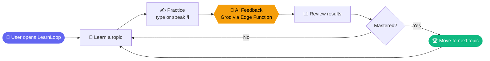
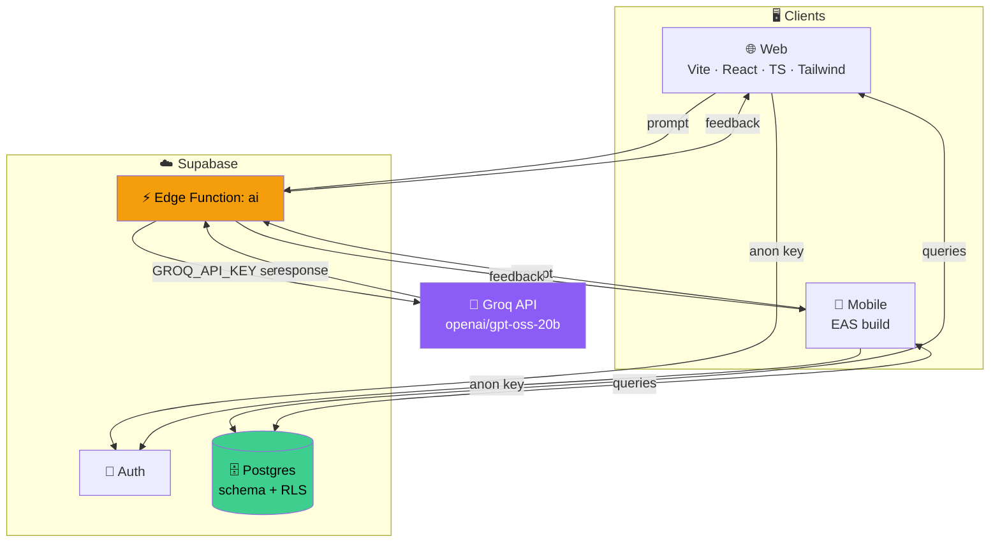
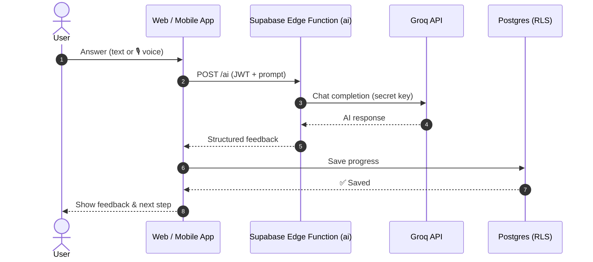
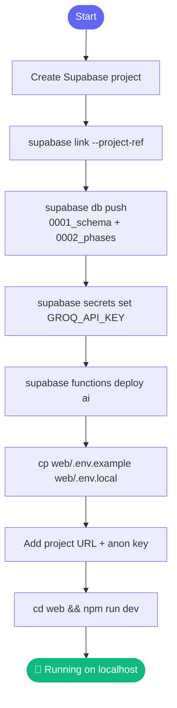
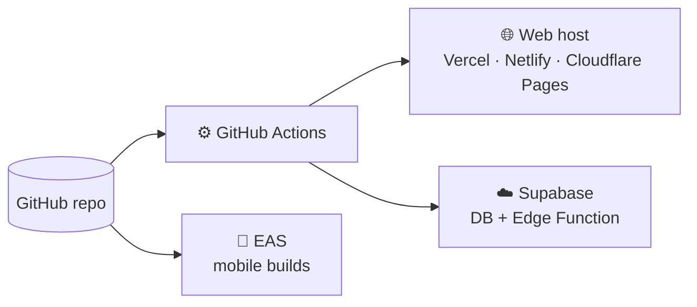

<div align="center">


<a href="https://github.com/HARIHARANMURALIREC/LearnLoop-">
  
</a>

<br/>


<br/><br/>

[](https://learnloop-orpin.vercel.app)


</div>

---

## 📚 Table of Contents
- [Overview](#-overview)
- [How It Works](#-how-it-works)
- [Architecture](#-architecture)
- [Request Sequence](#-ai-request-sequence)
- [Project Structure](#-project-structure)
- [Setup](#-setup)
- [Setup Flow](#-setup-flow)
- [Deployment](#-deployment)

---

## ✨ Overview

**LearnLoop** is a learning app built around a continuous loop: learn something, practice it, get AI feedback, and improve. It ships as a web app and a mobile app, backed by Supabase and an AI Edge Function powered by Groq.

| Part | What it is |
|------|-----------|
| 🌐 `web/` | Vite + React + TypeScript + Tailwind app |
| 📱 `mobile/` | Mobile client (built/deployed with EAS) |
| 🗄️ `supabase/` | SQL migrations (schema + RLS) and the `ai` Edge Function |
| ⚙️ `.github/workflows` | CI/CD automation |

> 🔐 The Groq API key lives **only** inside the Supabase Edge Function — it is never exposed to the browser.

---

## 🔁 How It Works



---

## 🏗️ Architecture



---

## 🔄 AI Request Sequence



---

## 📂 Project Structure

```text
LearnLoop-/
├── .github/workflows/   # CI/CD
├── mobile/              # Mobile app
├── supabase/
│   ├── migrations/
│   │   ├── 0001_schema.sql
│   │   └── 0002_phases.sql
│   └── functions/ai/    # Edge Function (holds Groq key)
├── web/                 # Vite + React + TS + Tailwind
├── DEPLOY.md            # Free deployment guide
└── README.md
```

---

## 🚀 Setup

1. **Create a Supabase project**, then link and push the schema:
   ```bash
   supabase link --project-ref <ref>
   supabase db push
   ```
2. **Set the AI secrets**:
   ```bash
   supabase secrets set GROQ_API_KEY=... [GROQ_MODEL=openai/gpt-oss-20b] [GROQ_FAST_MODEL=openai/gpt-oss-20b]
   ```
3. **Deploy the Edge Function**:
   ```bash
   supabase functions deploy ai
   ```
4. **Configure the web app**:
   ```bash
   cp web/.env.example web/.env.local   # add project URL + anon key
   ```
5. **Run it**:
   ```bash
   cd web && npm run dev
   ```

> 🎙️ **Voice input** needs Chrome or Edge (Web Speech API) and HTTPS or `localhost`.
> 🧱 `supabase db push` applies both migrations: `0001_schema.sql` and `0002_phases.sql`.

### 🧭 Setup Flow



---

## ☁️ Deployment



See **[DEPLOY.md](DEPLOY.md)** for the step-by-step free deployment guide (Cloudflare Pages / Netlify / Vercel, Supabase, EAS).

🔗 **Live:** https://learnloop-orpin.vercel.app

---

<div align="center">

Made with ❤️ by [HARIHARANMURALIREC](https://github.com/HARIHARANMURALIREC)


</div>

